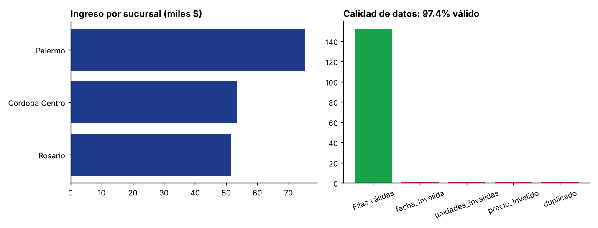

<div align="center">

# 🤖 Excel Report Autopilot

**Consolidá los Excel de todas tus sucursales, detectá errores automáticamente y generá el reporte mensual en segundos.**


</div>

---

## 🎯 Problema que resuelve

Cada fin de mes, alguien recibe 5, 10 o 50 archivos de sucursales: unos en `.xlsx`, otros en `.csv` con `;`, cada uno con encabezados distintos (`Fecha` / `Date` / `fecha_venta`), con duplicados, unidades negativas y fechas imposibles. Consolidarlos a mano lleva **horas** y los errores llegan al reporte de gerencia.

## 💡 Solución

Un pipeline de automatización en Python que:

1. **Lee** todos los archivos de una carpeta (`.xlsx` y `.csv`, detecta el separador).
2. **Normaliza** encabezados con un diccionario de sinónimos (español / inglés / variantes).
3. **Valida** 5 reglas de calidad y **separa** las filas con problemas, explicando el motivo.
4. **Genera** un Excel ejecutivo con formato (KPIs, región, sucursal, top productos, datos limpios, auditoría de calidad).
5. **Redacta** un resumen HTML listo para pegar en un email.

## 🛠️ Tecnologías usadas

`Python 3.10+` · `pandas` · `openpyxl` · `Jinja2` · `pytest` · `logging` · `argparse`

## ✅ Beneficios

- ⏱️ De **horas a segundos**: un comando reemplaza el copiar-pegar mensual.
- 🛡️ **Ningún error llega a gerencia sin ser visto**: cada fila excluida queda documentada en la hoja *Calidad de datos*.
- 🧩 **Extensible**: agregar un sinónimo de columna o una regla nueva es una línea de código.
- 📧 Resumen HTML listo para enviar.

## 📸 Capturas



```
INFO | Filas leídas: 156 de 3 archivos
INFO | Filas válidas: 152 · problemas: 4 · calidad: 97.4%
INFO | Reporte excel → outputs/reporte_ventas_20261123_2249.xlsx
INFO | Reporte html  → outputs/resumen_email_20261123_2249.html
```

## ⚙️ Instalación

```bash
git clone https://github.com/estela-oviedo/excel-report-autopilot-python.git
cd excel-report-autopilot-python
python -m venv .venv && source .venv/bin/activate   # Windows: .venv\Scripts\activate
pip install -r requirements.txt
```

## ▶️ Uso

```bash
python sample_data/make_samples.py                  # crea 3 archivos de ejemplo "desordenados"
python -m autopilot --input sample_data --output outputs
pytest -q
```

Con tus archivos: `python -m autopilot --input "C:/Ventas/Noviembre" --output "C:/Reportes"`.
Para que corra solo cada mes: Programador de tareas de Windows, `cron` en Linux/Mac o un workflow de GitHub Actions.

## 🏗️ Arquitectura

```
sample_data/*.xlsx|csv
        │
        ▼
 ingest.py  ── normaliza encabezados, tipos y texto
        │
        ▼
 quality.py ── 5 reglas ──► filas válidas │ filas con problema (+ motivo)
        │
        ▼
 report.py  ──► reporte_ventas.xlsx (6 hojas con formato)
            └─► resumen_email.html
```

Detalle en [`docs/ARCHITECTURE.md`](docs/ARCHITECTURE.md).

## 🗺️ Roadmap

- [x] Ingesta multi-formato + normalización de encabezados
- [x] Reglas de calidad con auditoría
- [x] Excel ejecutivo + resumen HTML
- [ ] Envío automático por email / Microsoft Teams
- [ ] Detección de anomalías con IA (ventas atípicas por sucursal)
- [ ] Ejecución programada con GitHub Actions

## 🤝 Contribuciones

Abrí un *issue* o un *pull request*. Para sumar una regla de calidad, agregala al diccionario `RULES` en `autopilot/quality.py` con su test.

## 📬 Contacto

**Estela Oviedo** — Data Analytics · Automatización · Python · IA
[LinkedIn](https://www.linkedin.com/in/estela-oviedo) · [GitHub](https://github.com/estela-oviedo)

---
<sub>Licencia MIT · Datos de ejemplo sintéticos.</sub>
